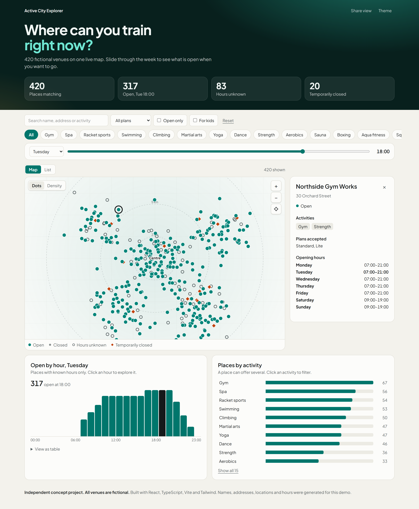

# Active City Explorer

Independent concept project. All venues are fictional.

**Live demo:** https://lachezar-atanasov.github.io/active-city-explorer/



An interactive React dashboard for finding sports venues: search, activity filters, a time slider, a dot and density map, a sortable list, venue details, charts that follow your filters, a shareable URL and light and dark themes.

Stack: React, TypeScript, Vite, Tailwind CSS. The map is plain SVG with no external map service.

## Run it

```
npm install
npm run dev
```

## Other commands

```
npm test            # opening hours, filters, URL state, map binning
npm run build       # typecheck and production build in dist/
npm run data        # regenerate the fictional dataset
```

## Data

`scripts/generate-demo-data.mjs` invents every venue with a seeded random generator. Missing hours are shown as unknown, never guessed.
